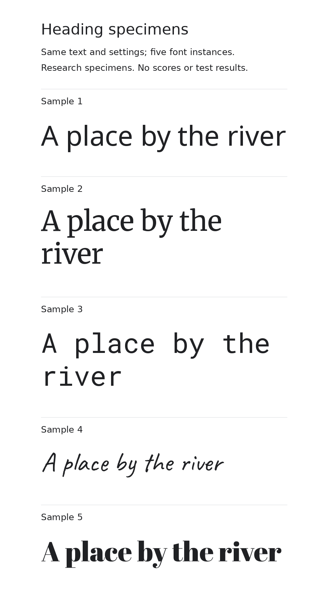
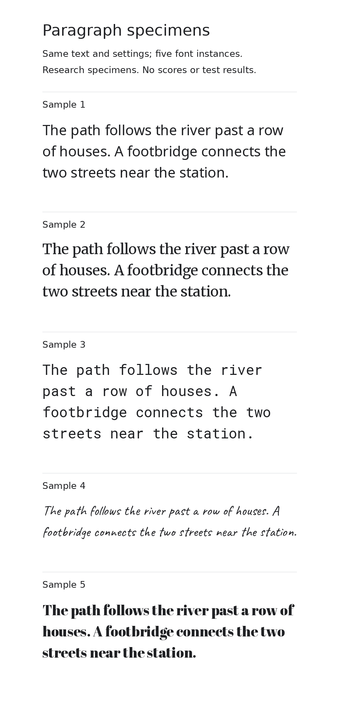
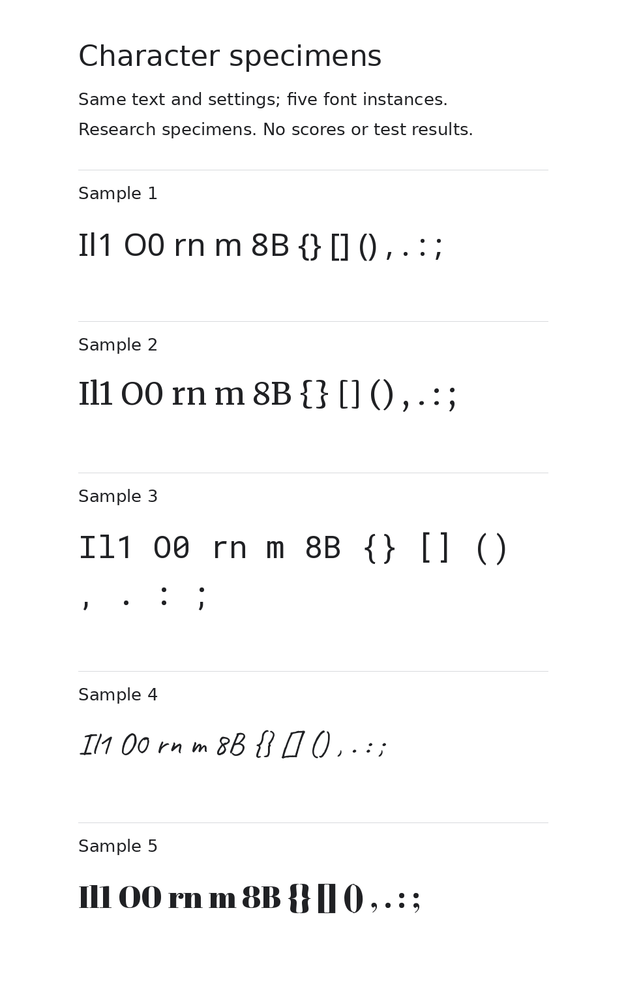

# Five-font research specimens

These sheets use the existing five-family pilot. They are rendered research artifacts, not a recommendation interface or completed reader study. No mood scores or reading-performance judgments have been assigned.

## View the samples

- [Heading specimens](heading-specimens.png)
- [Paragraph specimens](paragraph-specimens.png)
- [Character specimens](characters-specimens.png)
- [Settings, text, source hashes, and sample key](manifest.json)







## Sample key

| Sample | Family | Selected normal instance |
| --- | --- | --- |
| 1 | Noto Sans | Weight 400, width 100 |
| 2 | Merriweather | Weight 400, width 100, optical size 18 |
| 3 | Roboto Mono | Weight 400 |
| 4 | Caveat | Weight 400 |
| 5 | Abril Fatface | Static regular file |

Weight numbers are not measures of perceived darkness across families. The single static Abril Fatface style looks different from a normal variable instance even though both may carry the nominal value 400.

## Controls and limits

All specimens use the same words, foreground, background, nominal role size, and available line width within each sheet. Headings use 40 reference pixels, paragraphs 20, and characters 24. The raster scale is 2, so image dimensions are twice the reference dimensions. Reference sizes describe this renderer; they are not proof of identical browser/CSS layout or physical display size.

The different line breaks and visible letter sizes are retained rather than hidden. Equal nominal size does not produce equal perceived size. Line wrapping, letter shapes, and density can affect a mood judgment; a later comparison may need an explicitly separate matched-perceived-size condition.

The sample order is fixed for inspection. This is not the randomized four-option trial described in the protocol. The key is available here, so these pages are not a blinded participant study. Do not interpret sample order as a ranking.

The character sheet demonstrates glyph appearance. The labels or a known reference string can influence transcription tasks; prepare dedicated task materials before collecting character-recognition data.

Pillow/RAQM and statically instantiated local font files generated the images. Font files must match the pinned source hashes; no browser fallback is involved in this raster renderer. Font binaries are not included in the repository.

## Reproduce

Install Pillow and fontTools, obtain the exact source binaries listed in manifest.json, and name each local file <family-id>.ttf. Then run from the repository root:

```sh
python scripts/render_pilot_specimens.py /path/to/font-files research/specimens/batch-1
```

An optional third path selects a label font for the renderer. The default is the Linux DejaVu Sans path; another environment may need its own label-font path. The manifest records the label-font hash and renderer versions. Main specimens always use the verified pilot font binaries.

```sh
python scripts/render_pilot_specimens.py /path/to/font-files research/specimens/batch-1 /path/to/label-font.ttf
```

## Use in the next research step

First review whether the proposed mood words are understandable. Then use controlled subsets of these samples to ask an attribute question, separately from liking or project suitability. Create and record trial order, outcomes, and exact conditions before collecting responses. Actual reading and hierarchy tasks remain separate.
